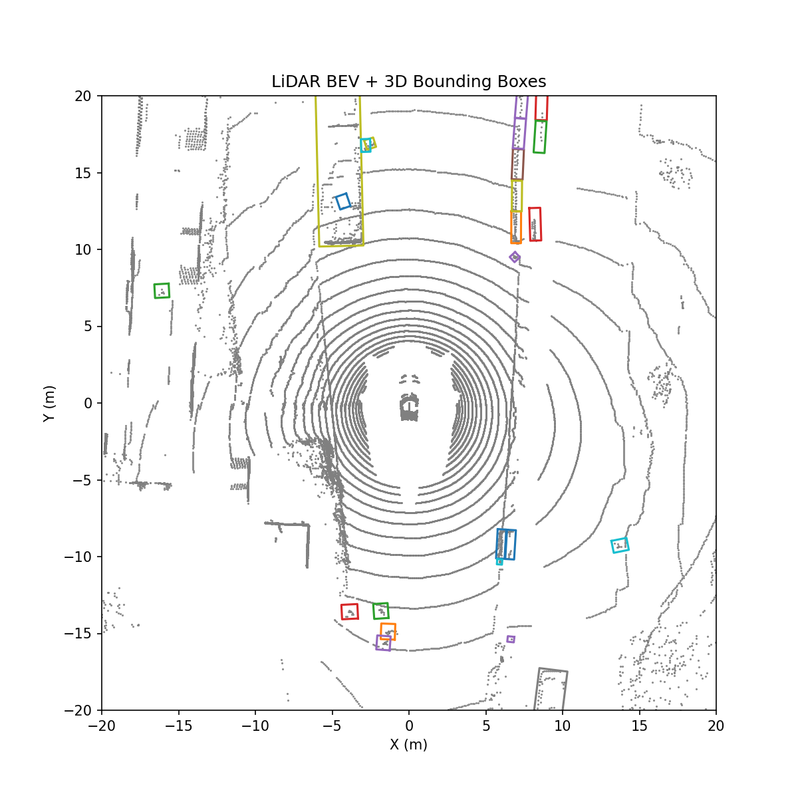

# Camera–LiDAR BEV Fusion

A lightweight, experimental implementation of camera–LiDAR feature fusion in bird's-eye view (BEV), built with PyTorch and `spconv` using the nuScenes dataset.

The project explores how multi-camera image features and LiDAR point-cloud features can be represented on a shared BEV grid and used for 3D object detection. It is a learning project, **not a reproduction of the official BEVFusion model**.

## Overview

- **Camera branch:** ResNet-18 features from six cameras, depth-bin lifting, and projection into the LiDAR-frame BEV grid.
- **LiDAR branch:** Point-cloud voxelization, a point-wise feature encoder, sparse 3D convolutions, and BEV feature compression.
- **Fusion:** Concatenation of camera and LiDAR BEV features followed by 2D convolutions.
- **Detection head:** BEV heatmap, center offset, height, dimensions, and rotation predictions.
- **Experiments:** Module tests, training scripts, prediction visualization, and a simple center-distance-based evaluation.

The fused feature map has shape **`[1, 64, 80, 80]`**, covering a **40 m × 40 m** region at **0.5 m** BEV resolution.

## BEV Visualization



*LiDAR points in BEV with nuScenes ground-truth 3D bounding boxes (not model predictions).*

## Repository Structure

```text
├── datasets/       # nuScenes sample loading and detection targets
├── models/         # Camera BEV, LiDAR BEV, fusion, and detection head
├── losses/         # Detection loss
├── tools/          # Training, evaluation, and visualization scripts
├── demo_test/      # Individual component tests and visualizations
└── assets/         # Images used in this README
```

## Requirements

- Python, PyTorch, torchvision
- CUDA-compatible GPU and `spconv`
- `nuscenes-devkit`, NumPy, OpenCV, Matplotlib, `pyquaternion`
- nuScenes dataset (download separately)

The scripts were developed on Windows with a GTX 1650 (4 GB). Some scripts contain local dataset and checkpoint paths, which need to be updated before running on another machine.

## Usage

After installing the dependencies and updating `DATAROOT` and checkpoint paths in the scripts, run from the repository root:

```bash
python -m tools.train
python -m tools.evaluate
```

Individual components can be explored in `demo_test/`. The code uses available nuScenes samples and includes a scene-level train/validation split.

## Notes

This is a small-scale experimental implementation. It includes a detection head and training/evaluation code, but the repository does **not** claim benchmark-level 3D detection performance or official nuScenes mAP/NDS results.
